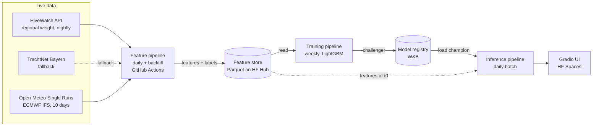

# Regional Nectar-Flow Forecast

> 10-day forecast of the daily net hive-weight change for the Central-Swiss pre-Alps (HiveWatch region *Nordalpen*), built as a live FTI system for HSLU I.BA_MLOPS HS26.

<!-- TODO MS4 video pitch link goes here (first line of README) -->

| | |
|---|---|
| **Milestone** | MS2, feature pipeline (due 05.11.2026) |
| **Proposal** | [docs/proposal.pdf](docs/proposal.pdf) |
| **MS2 summary & review response** | [docs/ms2_summary.pdf](docs/ms2_summary.pdf) |
| **Feature store** | [Whalesharkking/nectarflow-features](https://huggingface.co/datasets/Whalesharkking/nectarflow-features) (Hugging Face dataset) |

## What it predicts

Every morning the system forecasts the **net weight change in kg/day** of the monitored colonies in the *Nordalpen* region (roughly the cantons of Lucerne, Schwyz, Uri, Obwalden and Nidwalden), for today and the next nine days (horizon *h* = 1…10). The value is the regional average of about 364 scales (17.10.2026), with beekeeper interventions (feeding, honey removal, adding boxes) filtered out.

A positive value means the colonies collect more nectar than they consume. A negative value means they live on their stores.

The model must beat two baselines on per-horizon MAE:

- **Persistence:** every coming day repeats the last complete day.
- **Climatology:** the usual change for that date, averaged over 2019-2023 (±7 days).

The target is at least 10 % better than the better baseline for *h* = 1…5, and at least equal for *h* = 6…10.

## Architecture



| Component | Status |
|---|---|
| Feature pipeline (daily + backfill) | Done in MS2, see [`src/nectarflow/features/`](src/nectarflow/features/) |
| Feature store (Parquet on HF Hub) | Done in MS2, layout in [Feature store](#feature-store) |
| Training pipeline + W&B registry | Planned for MS3 |
| Inference pipeline + Gradio UI | Planned for MS4 |

## Data sources & permission to use

### Hive weight from HiveWatch / BienenSchweiz (primary)

- **Source:** the public scale map on [bienen.ch](https://bienen.ch/imkerei/zucht/waagvoelker/), operated by BienenSchweiz with HiveWatch.
- **Endpoint:** `GET https://app.hivewatch.net/region/11/averages?sensorType=ext_weight&startdate=<epoch ms>&enddate=<epoch ms>`. It needs no login and returns hourly, intervention-filtered weight for region 11 ("Nordalpen").
- **Permission:** the endpoint serves the public map and is not a documented API. On 15.10.2026 I asked BienenSchweiz and HiveWatch in writing. On **19.10.2026 HiveWatch granted permission** for this non-commercial project, based on clause 12 of its terms (anonymised data may be shared for research).
  - Automated polling of the regional averages during the project and a one-time download of the history from 2019 are allowed.
  - Derived regional daily values may be shown in this repository and on the demo page. No raw data and no data of single scales may be published, use must stay non-commercial, and the source must be credited as "HiveWatch ([www.hivewatch.ch](https://www.hivewatch.ch))".
- **Polling:** once per day, plus a one-time history download, and only for the duration of the project (until about January 2027).

### Fallback options for the hive weight (tested 15.10.2026)

| Source | Result | Usable as fallback? |
|---|---|---|
| HiveWatch `public/region/11/midnightvalues` | Regional daily deltas, but only for the last 8 days and from the same provider | No, not independent. It is used to cross-check the label |
| [Hiveeyes](https://swarm.hiveeyes.org) | Open API (no key). There are 332 public dashboards, none in Switzerland, and the sampled nodes are inactive (e.g. last data May 2023). It serves raw single-hive weight that still includes interventions | No |
| [TrachtNet](https://www.bienenkunde.rlp.de) (DLR Rheinland-Pfalz & LWG Bayern) | Public web portal without login. It provides daily **corrected** weight change per region and the **number of scales per day**. Data runs from 2011 and is fresh up to the previous day. Bayern had about 127 scales in 2019, about 250 in 2025 and about 335 in 2026. Switzerland has only 1 to 4 scales | **Yes**, Bayern / Oberbayern |

A permission request was also sent to TrachtNet (trachtnet@dlr.rlp.de) on 15.10.2026. No reply has been received so far (last checked 17.10.2026). Since HiveWatch granted access, the adapter is built only if that access breaks.

Switzerland has no other open hive-scale API. I checked the Romandie, Ticino, Agroscope and opendata.swiss.

### Weather forecasts from the Open-Meteo Single Runs API

- **Endpoint:** `https://single-runs-api.open-meteo.com/v1/forecast`. It serves every archived run of **ECMWF IFS HRES (9 km)** since 14.03.2024 and needs no key. The data comes from [Open-Meteo](https://open-meteo.com/) under CC BY 4.0.
- **Run used:** the 00 UTC run for four locations (Lucerne, Schwyz, Altdorf and Sarnen). The values are averaged and aggregated from hourly to daily.
- **Run completeness:** at 07:46 UTC the same day's 00 UTC run was only partly available (72 of 240 h). The pipeline therefore starts at 08:47 UTC, refuses to write a run with fewer than 240 hours, and polls again every 10 minutes for up to two hours (see [Schedule](#schedule)).
- **Rate limit:** one request with four locations counts as about four calls (the free tier allows 600 per minute and 5000 per hour). The backfill waits 1.5 s between runs and waits out HTTP 429.

## Label & features

One row per forecast day *t0* and horizon *h*. Each row stores **two dates**, the day the forecast was issued and the day it is for. Training therefore always uses real archived forecasts, never observed weather.

**Label**

- The label is the net weight change of one day, measured as the weight at midnight after the day minus the weight at midnight before it.
- Days without a midnight value stay empty and are not interpolated.
- Cross-checked against HiveWatch's own daily deltas (`public/region/11/midnightvalues`), the labels agree within 0.004 kg in September 2026 and within 0.018 kg (mean 0.007 kg) on 17.10.2026. HiveWatch computes those deltas slightly differently. The difference is small next to a daily change of 0.1 to 0.5 kg.
- A label counts as final only after 2 days, because scales can upload late.

**Features** (one row per issue date *t0* and horizon *h*, defined once in [`compute.py`](src/nectarflow/features/compute.py) and [`config.py`](src/nectarflow/common/config.py) for training and inference)

| Group | Columns |
|---|---|
| Weather forecast for the target day (run of *t0*, mean of the four locations, local calendar day) | `tmax`, `tmin` (°C), `precip_sum` (mm), `shortwave_sum` (MJ/m²), `wind_max` (km/h), `n_hours` (hours the day is built from) |
| Weight momentum | `mom_1d`, `mom_3d`, `mom_7d`, `mom_14d` with the net change over the last 1/3/7/14 days, **ending at t0−2** (final days only, review point A1). A window with a missing or flagged day is empty, never zero |
| Climatology | `clim_target` with the median change for the target day of year, 2019-2023, ±7 days, flagged days excluded |
| Calendar | `doy_sin`, `doy_cos` of the target date, horizon `h` |

**Data quality (review point A2)**

- `jump_flag` in the label table marks implausible daily changes, meaning more than 2.5 kg in April to July, more than 1.0 kg in the rest of the year. Real flow days reach about 1.7 kg. Larger changes come from snow load, frost or faulty scales. HiveWatch's filter (`filtered=true`) removes beekeeper interventions per scale, but not weather on the scale, so the flag catches what is left in the regional mean. In 2019 to 2026, 56 of 2813 days are flagged, none of them in the flow season (21 in January 2021 alone). Flagged days are removed from `label_clean`, the momentum and the climatology.
- `n_scales` is the number of scales in the region, read daily from `public/region/11` (`nofScales`, 364 on 17.10.2026) into `quality/n_scales.parquet`. HiveWatch keeps no history, so the series starts on the first polling day.

**Leakage controls**

- Every feature row is point-in-time correct. It carries its issue date and target date and uses only what was known and final on the morning of *t0*.
- Feature rows contain no label. Training joins `labels/labels.parquet` on `target_date` and keeps only rows with `is_final`.
- The backfill runs the same code as the daily job.
- The daily labels of the last 30 days are archived every day as computed on that day (`asof/labels/`), so MS3 can measure how much the last days still change (review point A1). The hourly series is only used in memory and is not published, as agreed with HiveWatch.
- The climatology uses only 2019-2023, so no training or test year enters it.

**Split**

- **Training:** forecast days from 14.03.2024 to 22.12.2025.
- **Test:** the unseen 2026 season.

## Feature store

A Hugging Face dataset repo with versioned Parquet files (“poor man's feature store”). The repo id is set by `HF_DATASET_REPO` ([Whalesharkking/nectarflow-features](https://huggingface.co/datasets/Whalesharkking/nectarflow-features)). The pipeline adds a dataset card with sources and licences on its first upload.

| Path | Content | Key | Written |
|---|---|---|---|
| `features/issue_date=YYYY-MM-DD.parquet` | ten feature rows of one issue date | `issue_date`, `target_date` | once per issue date |
| `labels/labels.parquet` | `label`, `is_final`, `jump_flag`, `label_clean` per day since 2019 | `date` | every run (labels become final) |
| `climatology/climatology.parquet` | median change per day of year, number of values | `doy` | every run |
| `raw/openmeteo/run=YYYY-MM-DD.parquet` | the hourly 00 UTC run per location, as fetched | `location`, `time` | once per run |
| `asof/labels/poll_date=YYYY-MM-DD.parquet` | daily labels of the last 30 days as computed on the poll date | `poll_date`, `date` | every run |
| `quality/n_scales.parquet` | scale count per poll date | `poll_date` | every run |

Every upload is one commit on the Hub, so every run creates a new dataset revision. That revision is the data version logged with each model in MS3. A run first writes to `DATA_DIR` and then uploads the written files. The backfill uploads every 100 issue dates and on errors, and a rerun skips issue dates already in the store.

## Run it

```bash
git clone https://github.com/Whalesharkking/mlops.git && cd mlops
cp .env.example .env          # set HF_TOKEN and HF_DATASET_REPO
uv sync --locked              # pinned dependencies from uv.lock
set -a && . ./.env && set +a

# daily run (today), same as the scheduled job
uv run python -m nectarflow.features.pipeline

# backfill a date range with the same code (about 30 min from 14.03.2024)
uv run python -m nectarflow.features.pipeline --start 2024-03-14 --end 2026-10-31

# without a Hugging Face account: write to DATA_DIR only
uv run python -m nectarflow.features.pipeline --local --start 2024-03-14 --end 2024-03-20

# or with Docker (non-root image, locked dependencies)
docker build -t nectarflow:dev .
docker run --rm --env-file .env nectarflow:dev
docker run --rm --env-file .env nectarflow:dev --start 2024-03-14
```

| Variable | Purpose |
|---|---|
| `HF_TOKEN` | write access to the feature-store dataset |
| `HF_DATASET_REPO` | dataset repo id, e.g. `user/nectarflow-features` |
| `DATA_DIR` | local working directory (default `data/`, gitignored) |

Secrets live only in `.env` (gitignored) locally and in GitHub Secrets in CI. `HF_DATASET_REPO` is a GitHub repository variable.

## Schedule

| Workflow | Trigger | What it does |
|---|---|---|
| [`feature-daily.yml`](.github/workflows/feature-daily.yml) | daily at 08:47 UTC by [cron-job.org](https://cron-job.org) via the `workflow_dispatch` API, because GitHub starts scheduled runs hours late. A GitHub cron at 14:23 UTC is the fallback and does nothing if today's features already exist | Polls HiveWatch and Open-Meteo, waits up to 2 h for a complete run, writes features, labels and raw data, pushes to the HF Hub. Fails if today's run never completes |
| [`backfill.yml`](.github/workflows/backfill.yml) | manual (`workflow_dispatch`) with start, end, force | Same module as the daily run, for a date range |
| [`ci.yml`](.github/workflows/ci.yml) | push / pull request | Lint (ruff), unit tests, builds and smoke-tests the Docker image, Trivy scan (fails on fixable critical CVEs) |
| [`render-pdf.yml`](.github/workflows/render-pdf.yml) | push to `docs/` | Renders the Typst docs to PDF |

The daily and backfill jobs share the `concurrency` group `feature-store`, so they never write at the same time.

## Tests

```bash
uv run pytest
uv run ruff check . && uv run ruff format --check .
```

Tests, lint and format check run without network in CI on every push:

- [`test_labels.py`](tests/test_labels.py) covers midnight-to-midnight label ignores the noon dip, :30 timestamps of 2019-2020, missing midnight stays empty, daylight-saving change, `is_final` after two days, seasonal `jump_flag`
- [`test_compute.py`](tests/test_compute.py) covers momentum windows end at t0−2 and never see non-final days, a gap makes a window empty, climatology uses only 2019-2023 and wraps around new year, ten rows with the right target dates and no label
- [`test_weather.py`](tests/test_weather.py) covers incomplete run is rejected, local calendar days, location mean, unit conversion, first hour not counted as zero
- [`test_pipeline.py`](tests/test_pipeline.py) covers an end-to-end run with fake APIs (backfill layout, incomplete run skipped, idempotent rerun)
- [`test_store.py`](tests/test_store.py) covers Hub upload in batches with a fake API, files already on the Hub are skipped, local mode never uploads

## Repository layout

```
src/nectarflow/
  common/config.py      constants, feature definitions, settings from the environment
  features/
    hivewatch.py        ingest: regional weight series and scale count
    weather.py          ingest: archived ECMWF runs, completeness check, daily aggregation
    labels.py           label, is_final, jump_flag
    compute.py          climatology, momentum, feature rows
    store.py            feature store on the Hugging Face Hub
    pipeline.py         entry point for the daily run and the backfill
tests/                  unit tests (run in CI)
docs/                   proposal, milestone summaries (Typst → PDF via CI)
.github/workflows/      scheduled pipelines and CI
Dockerfile              multi-stage, uv, non-root
pyproject.toml + uv.lock
.env.example
```

Milestones are tagged in Git (`ms2`, `ms3`, …).

## Credits

- **Hive data:** HiveWatch ([www.hivewatch.ch](https://www.hivewatch.ch)), regional averages of the BienenSchweiz scale network ([bienen.ch](https://bienen.ch)), used with permission of 19.10.2026.
- **Weather forecasts:** [Open-Meteo.com](https://open-meteo.com/) (CC BY 4.0), ECMWF IFS HRES.
- **Fallback hive data:** TrachtNet Deutschland (DLR Rheinland-Pfalz, LWG Bayern).
