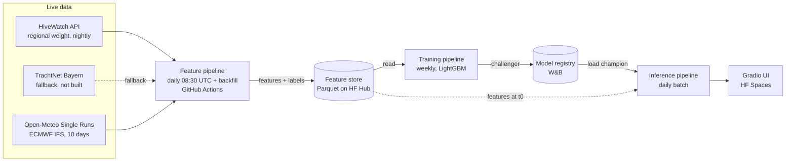

# Regional Nectar-Flow Forecast

> 10-day forecast of the daily net hive-weight change for the Central-Swiss pre-Alps (HiveWatch region *Nordalpen*), built as a live FTI system for HSLU I.BA_MLOPS HS26.

<!-- TODO MS4 video pitch link goes here (first line of README) -->

| | |
|---|---|
| **Milestone** | MS3, training pipeline (due 03.12.2026) |
| **Proposal** | [docs/proposal.pdf](docs/proposal.pdf) |
| **MS2 summary & review response** | [docs/ms2_summary.pdf](docs/ms2_summary.pdf) |
| **MS3 summary & review response** | [docs/ms3_summary.pdf](docs/ms3_summary.pdf) |
| **Feature store** | [Whalesharkking/nectarflow-features](https://huggingface.co/datasets/Whalesharkking/nectarflow-features) (Hugging Face dataset) |
| **Experiments & model registry** | W&B project `nectarflow`, registry collection `nectarflow-forecast` with alias `champion` |

## What it predicts

Every morning the system forecasts the **net weight change in kg/day** of the monitored colonies in the *Nordalpen* region (roughly the cantons of Lucerne, Schwyz, Uri, Obwalden and Nidwalden), for today and the next nine days (horizon *h* = 1…10). The value is the regional average of about 364 scales (17.10.2026), with beekeeper interventions (feeding, honey removal, adding boxes) filtered out.

A positive value means the colonies collect more nectar than they consume. A negative value means they live on their stores.

The model must beat two baselines on per-horizon MAE:

- **Persistence.** Every coming day repeats the last final day (t0−2).
- **Climatology.** The median change for that date over 2019-2023 (±7 days).

The target is at least 10 % better than the better baseline for *h* = 1…5, and at least equal for *h* = 6…10. On 2026, climatology is the better baseline at every horizon (MAE 0.25 kg/day, 0.30 in March to September). The model reaches 0.19 to 0.23 and meets the target at every horizon (see [Training pipeline](#training-pipeline)).

## Architecture



| Component | Status |
|---|---|
| Feature pipeline (daily + backfill) | Done in MS2, see [`src/nectarflow/features/`](src/nectarflow/features/) |
| Feature store (Parquet on HF Hub) | Done in MS2, layout in [Feature store](#feature-store) |
| Training pipeline + W&B registry | Done in MS3, see [`src/nectarflow/training/`](src/nectarflow/training/) |
| Inference pipeline + Gradio UI | Planned for MS4 |

## Data sources & permission to use

### Hive weight from HiveWatch / BienenSchweiz (primary)

- **Source.** The public scale map on [bienen.ch](https://bienen.ch/imkerei/zucht/waagvoelker/), operated by BienenSchweiz with HiveWatch.
- **Endpoint.** `GET https://app.hivewatch.net/region/11/averages?sensorType=ext_weight&startdate=<epoch ms>&enddate=<epoch ms>`. It needs no login and returns hourly, intervention-filtered weight for region 11 ("Nordalpen").
- **Permission.** I asked HiveWatch and BienenSchweiz in writing on 15.10.2026. **HiveWatch granted permission on 19.10.2026** for this non-commercial project. The terms are listed below.
  - Daily polling of the regional averages and a download of the history from 2019 are allowed for the duration of the project (until 10.01.2027). After that, the polling stops.
  - Derived regional daily values may be shown in this repository and on the demo page. The demo page may stay online after the project ends, without further polling.
  - Conditions are no raw data, no data of single scales, non-commercial use and the source credit "HiveWatch ([www.hivewatch.ch](https://www.hivewatch.ch))".

### Fallback options for the hive weight (tested 15.10.2026)

| Source | Result | Usable as fallback? |
|---|---|---|
| HiveWatch `public/region/11/midnightvalues` | Regional daily deltas, but only for the last 8 days and from the same provider | No, not independent. It is used to cross-check the label |
| [Hiveeyes](https://swarm.hiveeyes.org) | Open API (no key). There are 332 public dashboards, none in Switzerland, and the sampled nodes are inactive (e.g. last data May 2023). It serves raw single-hive weight that still includes interventions | No |
| [TrachtNet](https://www.bienenkunde.rlp.de) (DLR Rheinland-Pfalz & LWG Bayern) | Public web portal without login. It provides daily **corrected** weight change per region and the **number of scales per day**. Data runs from 2011 and is fresh up to the previous day. Bayern had about 127 scales in 2019, about 250 in 2025 and about 335 in 2026. Switzerland has only 1 to 4 scales | **Yes**, Bayern / Oberbayern |

TrachtNet was also asked on 15.10.2026 (no reply yet). Its adapter is only built if the HiveWatch access breaks. TrachtNet covers Bavaria, not the Nordalpen, so the model would then have to be retrained for the new region.

Switzerland has no other open hive-scale API. I checked the Romandie, Ticino, Agroscope and opendata.swiss.

### Weather forecasts from the Open-Meteo Single Runs API

- **Endpoint.** `https://single-runs-api.open-meteo.com/v1/forecast`. It serves every archived run of **ECMWF IFS HRES (9 km)** since 14.03.2024 and needs no key. The data comes from [Open-Meteo](https://open-meteo.com/) under CC BY 4.0.
- **Run used.** The 00 UTC run for four locations (Lucerne, Schwyz, Altdorf and Sarnen). The values are averaged and aggregated from hourly to daily.
- **Run completeness.** At 07:46 UTC the same day's 00 UTC run was only partly available (72 of 240 h). The pipeline therefore starts at 08:30 UTC, refuses to write a run with fewer than 240 hours, and polls again every 10 minutes for up to two hours (see [Schedule](#schedule)).
- **Rate limit.** One request with four locations counts as about four calls (the free tier allows 600 per minute and 5000 per hour). The backfill waits 1.5 s between runs and waits out HTTP 429.

## Label & features

One row per forecast day *t0* and horizon *h*. Each row stores **two dates**, the day the forecast was issued and the day it is for. Training therefore always uses real archived forecasts, never observed weather.

**Label**

- The label is the net weight change of one day, measured as the weight at midnight after the day minus the weight at midnight before it.
- Days without a midnight value stay empty and are not interpolated.
- Cross-checked against HiveWatch's own daily deltas (`public/region/11/midnightvalues`), the labels agree within 0.004 kg in September 2026 and within 0.018 kg (mean 0.007 kg) on 17.10.2026. HiveWatch computes those deltas slightly differently. The difference is small next to a daily change of 0.1 to 0.5 kg.
- A label counts as final only after 2 days, because scales can upload late. The as-of archive confirms this. From 17.10. to 25.11.2026 the label of the previous day was still missing at poll time on 35 of 40 days, and on every day since 22.10. The label of two days before was always there, and 0 of 68 labels changed after they first appeared. The daily run checks the label of two days before and fails if it is missing. [`quality.py`](src/nectarflow/features/quality.py) reports the weekly share of missing labels in every weekly training run.

**Features** (one row per issue date *t0* and horizon *h*, defined once in [`compute.py`](src/nectarflow/features/compute.py) and [`config.py`](src/nectarflow/common/config.py) for training and inference)

| Group | Columns |
|---|---|
| Weather forecast for the target day (run of *t0*, mean of the four locations, local calendar day) | `tmax`, `tmin` (°C), `precip_sum` (mm), `shortwave_sum` (MJ/m²), `wind_max` (km/h), `n_hours` (hours the day is built from) |
| Weight momentum | `mom_1d`, `mom_3d`, `mom_7d`, `mom_14d` with the net change over the last 1/3/7/14 days, **ending at t0−2** (final days only, review point A1). A window with a missing or flagged day is empty, never zero |
| Climatology | `clim_target` with the median change for the target day of year, 2019-2023, ±7 days, flagged days excluded |
| Calendar | `doy_sin`, `doy_cos` of the target date, horizon `h` |

**Data quality (review point A2)**

- `jump_flag` in the label table marks implausible daily changes, meaning more than 2.5 kg in April to July, more than 1.0 kg in the rest of the year. Real flow days reach about 1.7 kg. Larger changes come from snow load, frost or faulty scales. HiveWatch's filter (`filtered=true`) removes beekeeper interventions per scale, but not weather on the scale, so the flag catches what is left in the regional mean. In 2019 to 2026, 56 of 2813 days are flagged, none of them in the flow season (21 in January 2021 alone). Flagged days are removed from `label_clean`, the momentum and the climatology.
- **How HiveWatch averages.** HiveWatch sums the daily increases of all scales and divides them by the number of scales. A scale that joins or stops sending therefore does not shift the average. Scales that weigh less than 15 kg are left out. HiveWatch confirmed this by e-mail.
- `n_scales` is the number of scales in the region, read daily from `public/region/11` (`nofScales`, 364 on 17.10.2026) into `quality/n_scales.parquet`. HiveWatch keeps no history, so the series starts on the first polling day. For the years before, HiveWatch estimates about 50 scales in 2019 and a linear rise to 364 in 2026.

**Leakage controls**

- Every feature row is point-in-time correct. It carries its issue date and target date and uses only what was known and final on the morning of *t0*.
- Feature rows contain no label. Training joins `labels/labels.parquet` on `target_date` and keeps only rows with `is_final`.
- The backfill runs the same code as the daily job.
- The daily labels of the last 30 days are archived every day as computed on that day (`asof/labels/`), which measures how much the last days still change (review point A1). The hourly series is only used in memory and is not published, as agreed with HiveWatch.
- The climatology uses only 2019-2023, so no training or test year enters it.

**Split**

- **Training.** Forecast days from 14.03.2024 to 22.12.2025, so every training target lies in 2025 or earlier.
- **Test.** All forecast days of 2026. Only the baselines were looked at on 2026 before, the model is tested on it once.

## Feature store

A Hugging Face dataset repo with versioned Parquet files (“poor man's feature store”). The repo id is set by `HF_DATASET_REPO` ([Whalesharkking/nectarflow-features](https://huggingface.co/datasets/Whalesharkking/nectarflow-features)). The pipeline uploads a dataset card with sources, licences and the HiveWatch terms together with every upload.

| Path | Content | Key | Written |
|---|---|---|---|
| `features/issue_date=YYYY-MM-DD.parquet` | ten feature rows of one issue date | `issue_date`, `target_date` | once per issue date |
| `labels/labels.parquet` | `label`, `is_final`, `jump_flag`, `label_clean` per day since 2019 | `date` | every run (labels become final) |
| `climatology/climatology.parquet` | median change per day of year, number of values | `doy` | every run |
| `raw/openmeteo/run=YYYY-MM-DD.parquet` | the hourly 00 UTC run per location, as fetched | `location`, `time` | once per run |
| `asof/labels/poll_date=YYYY-MM-DD.parquet` | daily labels of the last 30 days as computed on the poll date | `poll_date`, `date` | every run |
| `quality/n_scales.parquet` | scale count per poll date | `poll_date` | every run |

Every upload is one commit on the Hub, so every run creates a new dataset revision. That revision is the data version logged with each model in MS3. A run first writes to `DATA_DIR` and then uploads the written files. The backfill uploads every 100 issue dates and on errors, and a rerun skips issue dates already in the store.

## Training pipeline

The training pipeline reads the feature store at one pinned dataset revision, trains one LightGBM model for all ten horizons (*h* is a feature), evaluates it per horizon against both baselines, logs everything to W&B and registers the model. Code is in [`src/nectarflow/training/`](src/nectarflow/training/).

| Step | Module | What it does |
|---|---|---|
| Read | [`data.py`](src/nectarflow/training/data.py) | Downloads features and labels of one Hub revision and returns its commit id. Joins the label on `target_date`, keeps only final labels |
| Split | [`cv.py`](src/nectarflow/training/cv.py) | Expanding-window folds over issue dates, one block per month April to September 2025, 10 days gap before each block, all ten rows of an issue date in one fold |
| Evaluate | [`evaluate.py`](src/nectarflow/training/evaluate.py) | MAE per horizon with row counts for persistence, climatology and the model, all on the same rows, plus the success criterion |
| Gate | [`gate.py`](src/nectarflow/training/gate.py) | Decides on promotion, see below |
| Register | [`registry.py`](src/nectarflow/training/registry.py) | Logs the model as W&B artifact and links it to the registry. Only the gate moves the alias `champion` |
| Train | [`train.py`](src/nectarflow/training/train.py) | Entry point for both protocols |

**Two protocols**

- **Evaluation (`--mode eval`, manual).** An Optuna search (50 trials, seeded, with a time budget) runs on the CV of the training period. The model is then trained on the whole training period with a fixed number of rounds (median of the best CV iterations) and tested once on 2026. The chosen parameters go to [`configs/model.json`](configs/model.json). A run in Actions uploads this file as workflow artifact. The file is then committed by hand, and the weekly retrain only uses the committed version.
- **Weekly retrain (`--mode retrain`).** The model is trained from scratch with the frozen parameters of `configs/model.json` on the newest revision. The last eight weeks of issue dates with final labels are the holdout, the training data ends ten days before it.

**Promotion gate.** The gate compares challenger, champion and both baselines on the holdout rows whose target lies in March to September. A challenger becomes champion only if it is at least 0.01 kg/day better than the champion and better than both baselines. Two season rules keep winter out (review point A3). The holdout must end in March to September, and it must hold at least 200 rows with a target in that window. So nothing is promoted from October to February, and in March the 200 rows are reached only towards the end of the month. Polling ends on 10.01.2027, so within this project the only champion is the first one. The gate refuses the comparison if the champion was trained on a holdout day. The first champion comes from the evaluation protocol, if it beats both baselines on the 2026 season.

**Model artifact.** `model.txt` (LightGBM) and `model.json` with the feature columns, both targets, the training period, `train_end`, the dataset revision, the Git commit, the parameters and the scores. The inference pipeline (MS4) checks its input columns against this list.

**Choices**

- The model is trained on `label_clean` and evaluated on the raw `label`, so a flagged day still counts as an error.
- LightGBM uses the L1 objective (the metric is MAE), a fixed seed and deterministic mode. Two runs on the same revision give the same model.
- Almost all of the gain over climatology comes from the weather forecast. `--mode ablation` retrains with the frozen config without each feature group. Without the weather the model reaches 0.247 (season 0.285), the level of climatology. Without the momentum it stays at 0.207.
- The season window is March to September, not April to July as in the proposal. The gate needs the same window for its rule, and April to July would leave out March, August and September.
- `n_scales` is not a feature, because it would be a linear guess in training and a real count in serving. As a sample weight it made the CV worse (MAE 0.188 instead of 0.184), so it is not used (review point E4).

**Result** (dataset revision `cae98fa`, test on issue dates 01.01. to 23.11.2026, MAE in kg/day)

| *h* | 1 | 2 | 3 | 4 | 5 | 6 | 7 | 8 | 9 | 10 |
|---|---|---|---|---|---|---|---|---|---|---|
| rows | 320 | 319 | 318 | 317 | 316 | 315 | 314 | 313 | 312 | 311 |
| persistence | 0.265 | 0.294 | 0.300 | 0.298 | 0.324 | 0.325 | 0.343 | 0.372 | 0.381 | 0.375 |
| climatology | 0.250 | 0.255 | 0.255 | 0.255 | 0.256 | 0.257 | 0.255 | 0.257 | 0.255 | 0.248 |
| LightGBM | 0.192 | 0.197 | 0.201 | 0.197 | 0.199 | 0.203 | 0.213 | 0.220 | 0.223 | 0.227 |

The model meets the success criterion at every horizon. In March to September 2026 (2080 rows) it reaches 0.230 against 0.297 for climatology and 0.369 for persistence.

## Run it

```bash
git clone https://github.com/Whalesharkking/mlops.git && cd mlops
cp .env.example .env          # set HF_TOKEN and HF_DATASET_REPO
uv sync --locked              # pinned dependencies from uv.lock
set -a && . ./.env && set +a

# daily run (today), same as the scheduled job
uv run python -m nectarflow.features.pipeline

# backfill a date range with the same code (about 30 min from 14.03.2024)
uv run python -m nectarflow.features.pipeline --start 2024-03-14 --end 2026-10-31

# without a Hugging Face account: write to DATA_DIR only
uv run python -m nectarflow.features.pipeline --local --start 2024-03-14 --end 2024-03-20

# baselines per horizon up to a fixed date, at a pinned revision (review point B3)
uv run python -m nectarflow.training.evaluate --until 2026-11-23 --revision cae98fabe29d48c27b70249432dca552062ae6af

# training: evaluation protocol (search, test on 2026) and the weekly retrain
uv run python -m nectarflow.training.train --mode eval --revision cae98fabe29d48c27b70249432dca552062ae6af
uv run python -m nectarflow.training.train --mode retrain
# feature ablation on 2026 with the frozen config (no W&B needed)
uv run python -m nectarflow.training.train --mode ablation --revision cae98fabe29d48c27b70249432dca552062ae6af
# without a W&B account: W&B offline and a local registry in DATA_DIR/registry
uv run python -m nectarflow.training.train --mode retrain --offline

# label quality from the as-of archive
uv run python -m nectarflow.features.quality

# or with Docker (non-root image, locked dependencies)
docker build -t nectarflow:dev .
docker run --rm --env-file .env nectarflow:dev
docker run --rm --env-file .env nectarflow:dev --start 2024-03-14
```

| Variable | Purpose |
|---|---|
| `HF_TOKEN` | write access to the feature-store dataset (training only reads, the dataset is public) |
| `WANDB_API_KEY` | W&B experiment tracking and model registry (training only) |
| `HF_DATASET_REPO` | dataset repo id, e.g. `user/nectarflow-features` |
| `DATA_DIR` | local working directory (default `data/`, gitignored) |

Secrets live only in `.env` (gitignored) locally and in GitHub Secrets in CI. `HF_DATASET_REPO` is a GitHub repository variable.

## Schedule

| Workflow | Trigger | What it does |
|---|---|---|
| [`feature-daily.yml`](.github/workflows/feature-daily.yml) | daily 08:30 UTC by cron-job.org, or manual | Polls HiveWatch and Open-Meteo, waits up to 2 h for a complete run, writes features, labels and the raw weather run, pushes to the HF Hub. Fails if today's run never completes |
| [`train.yml`](.github/workflows/train.yml) | weekly Monday 12:00 UTC (GitHub cron), or manual with mode and revision | Weekly retrain with the gate, then the label quality report (it never blocks the training). Manual `eval` reruns the evaluation protocol and uploads `configs/model.json` as artifact |
| [`backfill.yml`](.github/workflows/backfill.yml) | manual (`workflow_dispatch`) with start, end, force | Same module as the daily run, for a date range |
| [`ci.yml`](.github/workflows/ci.yml) | push / pull request | Lint (ruff), unit tests, builds and smoke-tests the Docker image, Trivy scan (fails on fixable critical CVEs) |
| [`render-pdf.yml`](.github/workflows/render-pdf.yml) | push to `docs/` | Renders the Typst docs to PDF |

The daily and backfill jobs share the `concurrency` group `feature-store`, so they never write at the same time.

**How the daily run is started.** GitHub starts scheduled runs hours late. [cron-job.org](https://cron-job.org) therefore triggers the workflow every day at 08:30 UTC through the GitHub API.

```
POST https://api.github.com/repos/Whalesharkking/mlops/actions/workflows/feature-daily.yml/dispatches
Authorization: Bearer <fine-grained token with Actions read/write on this repo only>
Body: {"ref": "main"}
```

The token is stored only at cron-job.org. To set the trigger up again:

1. On GitHub, create a fine-grained token (Settings, Developer settings) for this repository only, with the permission Actions read and write.
2. On cron-job.org, create a job with the URL above, method POST, schedule daily 08:30 UTC.
3. Add the headers `Authorization: Bearer <token>`, `Accept: application/vnd.github+json` and the body `{"ref": "main"}`.
4. Run the job once by hand and check that a run appears in the Actions tab.

The weekly retrain may start late, so it uses a normal GitHub cron. There is no GitHub cron as fallback for the daily run, because a run started many hours late can fall after midnight, before the new weather run exists. If cron-job.org misses a day, the run can be started by hand in the Actions tab. A missed day can also be filled later with the backfill.

## Tests

```bash
uv run pytest
uv run ruff check . && uv run ruff format --check .
```

Tests, lint and format check run without network in CI on every push:

- [`test_labels.py`](tests/test_labels.py) checks that the label runs from midnight to midnight and ignores the noon dip. It also covers the half-hour timestamps of 2019-2020, a missing midnight, the daylight-saving change, `is_final` after two days and the seasonal `jump_flag`.
- [`test_compute.py`](tests/test_compute.py) checks that momentum windows end at t0−2 and never see non-final days, and that a gap makes a window empty. It also checks that the climatology uses only 2019-2023 and wraps around new year, and that each issue date gets ten rows without a label.
- [`test_weather.py`](tests/test_weather.py) checks that incomplete or missing runs are rejected. It also covers local calendar days, the mean over the locations, the unit conversion and the first hour, which must not count as zero.
- [`test_pipeline.py`](tests/test_pipeline.py) runs the whole pipeline with fake APIs. It checks the store layout, that an incomplete run is skipped, that a rerun changes nothing and that the as-of archive holds daily labels only.
- [`test_pipeline.py`](tests/test_pipeline.py) also checks that a failed scale count leaves only an empty value, that a missing label of t0−2 is flagged while the features are still written and the job then exits with an error, and that the run uploads what it has even if HiveWatch fails.
- [`test_hivewatch.py`](tests/test_hivewatch.py) checks the retry on outages and the immediate failure on client errors.
- [`test_quality.py`](tests/test_quality.py) checks the missing-label shares and the label changes from as-of snapshots.
- [`test_training.py`](tests/test_training.py) runs the training pipeline on synthetic data. It checks the join on `target_date` with final labels only, the pinned revision, that CV folds never share a target and keep issue dates whole, that all predictors are scored on the same rows, every branch of the gate and the refusal of a champion that saw the holdout. Both protocols run end to end with a local registry. The champion alias follows the gate, a second evaluation never replaces the champion, a retrain without champion stops, and two fits give the same predictions. The W&B registry is tested with a fake API, only a "not found" counts as no champion.
- [`test_store.py`](tests/test_store.py) checks the upload to the Hub with a fake API. Written files and the dataset card go up in one commit, files already on the Hub are skipped and local mode never uploads.

## Repository layout

```
src/nectarflow/
  common/config.py      constants, feature definitions, settings from the environment
  features/
    hivewatch.py        ingest: regional weight series and scale count
    weather.py          ingest: archived ECMWF runs, completeness check, daily aggregation
    labels.py           label, is_final, jump_flag
    compute.py          climatology, momentum, feature rows
    store.py            feature store on the Hugging Face Hub
    pipeline.py         entry point for the daily run and the backfill
    quality.py          label availability and changes from the as-of archive
  training/
    data.py             read features and final labels at a pinned revision
    cv.py               expanding-window folds and gate holdout over issue dates
    evaluate.py         MAE per horizon for baselines and model, success criterion
    gate.py             champion/challenger gate
    registry.py         W&B registry (local registry for tests and offline runs)
    train.py            entry point for evaluation and weekly retrain
configs/model.json      frozen model parameters from the evaluation protocol
tests/                  unit tests (run in CI)
docs/                   proposal, milestone summaries (Typst → PDF via CI)
.github/workflows/      scheduled pipelines and CI
Dockerfile              multi-stage, uv, non-root
pyproject.toml + uv.lock
.env.example
```

Milestones are tagged in Git (`ms2`, `ms3`, …).

## Credits

- **Hive data.** HiveWatch ([www.hivewatch.ch](https://www.hivewatch.ch)), regional averages of the BienenSchweiz scale network ([bienen.ch](https://bienen.ch)), used with permission of 19.10.2026.
- **Weather forecasts.** [Open-Meteo.com](https://open-meteo.com/) (CC BY 4.0), ECMWF IFS HRES.
- **Fallback hive data.** TrachtNet Deutschland (DLR Rheinland-Pfalz, LWG Bayern).
